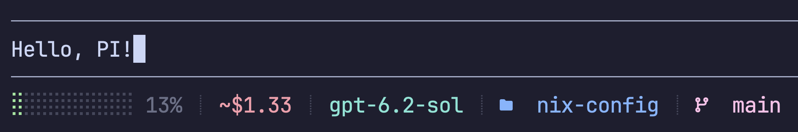

# Pi Status

A live, theme-aware status line for [Pi](https://pi.dev), inspired by
[Claude Status](https://github.com/claude-contrib/claude-status).

[](https://raw.githubusercontent.com/pi-contrib/pi-status/main/docs/status-line.png)

[View the full-resolution screenshot](https://raw.githubusercontent.com/pi-contrib/pi-status/main/docs/status-line.png).

## How it works

Pi Status follows your active Pi theme and replaces the interactive footer with context usage, estimated model usage cost,
model, directory, and Git branch. Cost is calculated from the active conversation branch,
not a billing record. The layout adapts to narrow terminals and preserves other extensions’
status messages on a second line.

## Requirements

- Pi 1.6.0 (the version checked in CI)
- A true-color terminal and a Nerd Font for the icons

## Installation

After the first release, install from GitHub without a registry login:

```sh
pi install git:github.com/pi-contrib/pi-status@v0.1.0
```

Or, after configuring npm authentication for `npm.pkg.github.com` and the `@pi-contrib`
scope, install from GitHub Packages:

```sh
pi install npm:@pi-contrib/pi-status@0.1.0
```

Restart Pi or run `/reload`. No extra configuration is required.

## Development

Use Node.js 22 locally or enter the Nix dev shell with `nix develop`:

```sh
npm ci --ignore-scripts
npm run check
npm pack --dry-run
pi -e ./index.ts
```

Release Please creates release PRs. Merging one tags the release and publishes the npm
package to GitHub Packages. The repository must allow Actions to create pull requests,
and the organization must allow the workflow to publish packages.

## License

MIT. The footer layout and palette are adapted from Claude Status.
